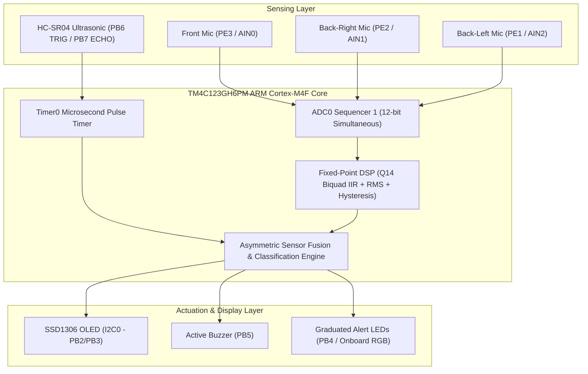

# GhostSense: Pre-Visual Vehicle Detection in Dense Fog via Acoustic-Pressure Sensing & Ultrasonic Fusion

[-blue.svg)](https://www.ti.com/tool/EK-TM4C123GXL)
[](#firmware-architecture)
[-darkgreen.svg)](#keil-mdk-build--testing-stages)
[](#team--mentorship)

> **GhostSense** is a non-visual, edge-processed collision warning embedded system designed to detect approaching vehicles in dense fog long before headlights or optical Advanced Driver Assistance Systems (ADAS) become visible. Built from the ground up on the Texas Instruments **TM4C123GH6PM** ARM Cortex-M4F microcontroller using bare-metal register-level Embedded C and fixed-point digital signal processing.

---

## 📌 Problem Overview & Physical Insight

* **The Challenge:** Dense fog attenuates and scatters visible light, creating severe optical contrast degradation. Traditional camera-based vision systems (e.g., YOLO/CNNs) degrade rapidly, and headlights provide insufficient preview distance at highway speeds. LiDAR similarly suffers from droplet backscatter. Moving vehicles appear at dangerously short distances ("ghost vehicles"), precipitating chain-reaction pileups.
* **The Non-Visual Solution:** Moving vehicles produce mechanical and acoustic pressure disturbances (engine vibration, tire-road displacement friction, aerodynamic turbulence) that propagate through atmospheric fog at rates orders of magnitude less attenuated than visible light.
* **Our Approach:** By coupling a multi-channel array of low-frequency analog acoustic/pressure sensors with an ultrasonic Time-of-Flight (ToF) rangefinder, GhostSense continuously profiles ambient baselines, detects approaching pressure signatures, and deterministically measures distance without relying on light.

---

## ⚙️ System Architecture



---

## 🔬 Signal Processing & Embedded Algorithms

Implemented in [`GhostVehicle_Keil/dsp.c`](GhostVehicle_Keil/dsp.c) with zero vendor library dependence:

1. **Quiet Baseline Profiling:**
   * At power-up, the system samples 32 quiet bursts (256 samples per burst at 8 kHz paced by SysTick) to determine ambient baseline RMS and variance ($\sigma$) for each channel.
2. **Fixed-Point Q14 Biquad Bandpass Filter:**
   * Eliminates DC bias and isolates vehicular acoustic frequencies (~1 kHz, Q = 0.7) using 16-bit fixed-point integer arithmetic with no floating-point hardware overhead.
3. **Adaptive Thresholding with Hysteresis:**
   * Dynamic threshold trigger:
     $$\text{Threshold}_{\text{ON}} = \text{Baseline} + 3\sigma + 2$$
   * Release threshold is set to $\frac{2}{3}$ of the margin to prevent chatter/rapid oscillating state switches.
4. **Asymmetric Proximity Classification:**
   * Ultrasonic distance acts as primary proximity classifier; acoustic channels provide corroboration and directional angle of approach.

---

## 📊 Proximity Bands & Alert Hierarchy

| Distance Range (Scaled 35 cm Box) | Proximity Classification | OLED Display Status | Alert Output |
| :--- | :--- | :--- | :--- |
| **> 30 cm** | `MONITORING...` | Real-time distance + Sound level | LED OFF / Buzzer OFF |
| **20 cm – 30 cm** | `CAR DETECTED` | Real-time distance + Direction | LED ON / Buzzer OFF |
| **10 cm – 20 cm** | `APPROACHING!` | Alert banner + Direction | LED ON / Buzzer OFF |
| **< 10 cm** | `!!CRITICAL!!` | Flashing alert + Range | LED ON + **Buzzer ACTIVE** |
| **Timeout / No Pulse** | `NO ECHO / CLEAR` | Idle monitor | LED OFF / Buzzer OFF |

---

## 🔌 Hardware Pinout Mapping

| Component | Pin Function | TM4C123GH6PM Pin | Description |
| :--- | :--- | :--- | :--- |
| **MAX4466 Mic 1** | Front Analog Out | **PE3 (AIN0)** | ADC0 Sample Sequencer 1 (Step 0) |
| **MAX4466 Mic 2** | Back-Right Analog Out | **PE2 (AIN1)** | ADC0 Sample Sequencer 1 (Step 1) |
| **MAX4466 Mic 3** | Back-Left Analog Out | **PE1 (AIN2)** | ADC0 Sample Sequencer 1 (Step 2) |
| **SSD1306 OLED** | I2C Serial Data | **PB3** | I2C0 SDA (Fast 400 kHz line padded) |
| **SSD1306 OLED** | I2C Serial Clock | **PB2** | I2C0 SCL |
| **HC-SR04** | Ultrasonic Trigger | **PB6** | 10 µs trigger pulse |
| **HC-SR04** | Ultrasonic Echo | **PB7** | Timer0 ToF capture (100 µs – 38 ms) |
| **Active Buzzer** | Alert Signal | **PB5** | GPIO Output (Critical warning) |
| **Alert Indicator** | Visual Indicator | **PB4** | GPIO Output |
| **Power Bus** | VCC / GND | **3.3V / GND** | Common ground across all breadboards |

---

## 📁 Repository Structure

```
GhostSense/
├── GhostVehicle_Keil/             # Complete Bare-Metal C Firmware
│   ├── main.c                     # Multi-stage execution loop & fusion engine
│   ├── adc.c / adc.h              # 3-channel ADC0 Sequencer 1 register driver
│   ├── dsp.c / dsp.h              # Fixed-point Q14 biquad IIR filter & RMS logic
│   ├── ultrasonic.c / .h          # Timer0-based microsecond ToF ultrasonic driver
│   ├── oled.c / oled.h            # Optimized line-buffered SSD1306 I2C driver
│   ├── font.c / font.h            # 5x7 ASCII monospace bitmap font table
│   ├── buzzer.c / buzzer.h        # GPIO buzzer control
│   ├── delay.c / delay.h          # Hardware calibrated delay utilities
│   ├── util.c / util.h            # Safe string and integer-to-string formatters
│   └── README_KEIL_STEPS.txt      # Step-by-step Keil compilation guide
├── docs/                          # Academic & Technical Documentation
│   ├── Embedded_Report.docx       # Full IEEE-format technical publication report
│   ├── Procedure.docx             # Experimental bring-up and verification protocol
│   ├── Ghost_Vehicle_4_Sensor_Connection_and_Final_Code.pdf
│   └── Review_*.pptx / .pdf       # Design review presentation slide decks (0 to 3)
├── .gitignore                     # Keil build artifacts and OS ignores
└── README.md                      # Primary project documentation
```

---

## 🚀 Keil MDK Build & Testing Stages

The firmware features an incremental bring-up switch configured via `#define STAGE <N>` in [`GhostVehicle_Keil/main.c`](GhostVehicle_Keil/main.c):

* **Stage 1:** Onboard LaunchPad RGB LED blink test (Clock verify).
* **Stage 2:** Single-channel ADC read verification via Watch window.
* **Stage 3:** SSD1306 I2C bus probing and static text display.
* **Stage 4:** Live single-microphone waveform/bar display on OLED.
* **Stage 5:** 3-channel simultaneous acoustic sampling and visualizer.
* **Stage 6:** Buzzer hardware trigger test.
* **Stage 7:** Ultrasonic distance measurement with live OLED feedback.
* **Stage 8:** Asymmetric sensor fusion (distance + raw acoustic corroborate).
* **Stage 9:** Dynamic acoustic noise profiling and fixed-point DSP bandpass filter.
* **Stage 10 (FINAL):** Full integrated fusion system (DSP-filtered acoustic verification + ultrasonic distance hierarchy + multi-tier alerts).

### Compilation Steps:
1. Open **Keil uVision 5**.
2. Create or open project targeting **TI TM4C123GH6PM**.
3. Under *Manage Run-Time Environment*, select **CMSIS > CORE** and **Device > Startup**.
4. Set compiler language to **C99** in *Options for Target > C/C++*.
5. Set debugger to **Stellaris ICDI** in *Debug* settings.
6. Build (`F7`) and Flash (`F8`).

---

## 👥 Team & Mentorship

* **Course:** 23CCE384 — Design Based Project (Embedded Systems Lab)
* **Institution:** Amrita School of Engineering, Amrita Vishwa Vidyapeetham, Chennai

### Team Members (Batch 11):
* **Akshaya M V** (`CH.EN.U4CCE24003`)
* **Devadharshini P** (`CH.EN.U4CCE24004`)
* **Mukesh M** (`CH.EN.U4CCE24015`)

### Faculty Mentor:
* **Dr. C. Ganesh Kumar**  
  *Chairperson & Assistant Professor, Department of Electronics & Communication Engineering*  
  *Amrita School of Engineering, Amrita Vishwa Vidyapeetham, Chennai*
