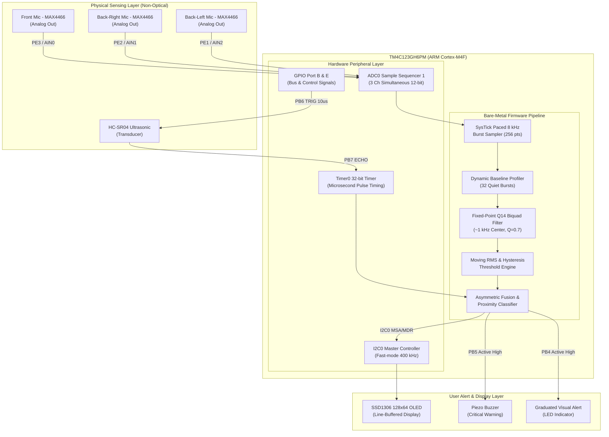
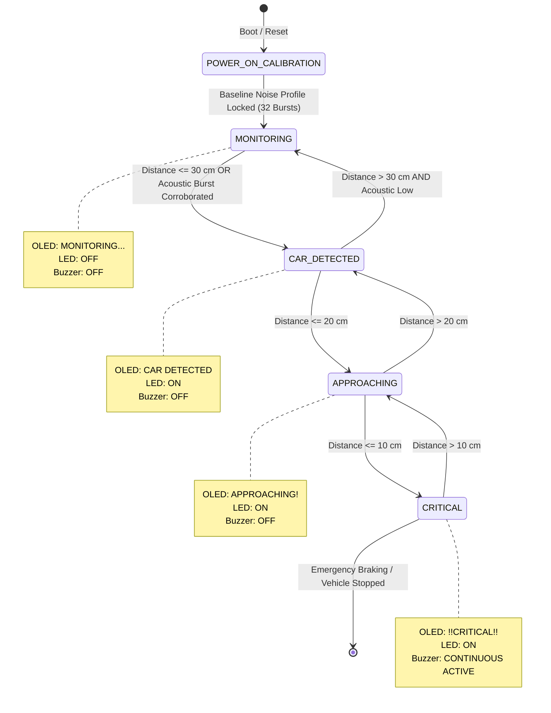

# GhostSense: Technical Design Document (TDD)

**Project Title:** Pre-Visual Vehicle Detection in Dense Fog via Acoustic-Pressure Sensing and Ultrasonic Fusion  
**Target Hardware:** Texas Instruments TM4C123GH6PM (ARM Cortex-M4F LaunchPad)  
**Firmware Architecture:** Bare-Metal Register-Level Embedded C (No Vendor HAL)  
**Authors:** Akshaya M V, Devadharshini P, Mukesh M  
**Faculty Mentor:** Dr. C. Ganesh Kumar  
**Institution:** Department of ECE, Amrita Vishwa Vidyapeetham, Chennai  

---

## 1. System Overview

**GhostSense** is an embedded safety architecture designed to detect approaching vehicles in dense fog before they become visible to optical sensors (cameras, LiDAR, and human vision). It addresses the optical attenuation barrier by measuring mechanical and acoustic pressure waves generated by moving vehicles (engine rumble, tire-road displacement friction) and fusing them with ultrasonic Time-of-Flight (ToF) ranging on a single ARM Cortex-M4F microcontroller.

---

## 2. Hardware Architecture & System Interconnects

The system is partitioned into three physical subsystems:
1. **Sensing Array:** 3x analog electret pressure/acoustic sensors (MAX4466) positioned spatially, plus an HC-SR04 ultrasonic transducer.
2. **Compute Core:** TI TM4C123GH6PM microcontroller operating at 16/80 MHz.
3. **Actuation & Telemetry:** SSD1306 128x64 OLED display over I2C0, active piezoelectric buzzer, and graduated alert LEDs.

### System Block Diagram

---

## 3. Peripheral Register Mapping & Resource Allocation

| Subsystem | TM4C123 Peripheral | Register Configuration | Purpose |
| :--- | :--- | :--- | :--- |
| **Acoustic Array** | `ADC0` (Sequencer 1) | `SSMUX1 = 0x00000210`, `SSCTL1 = 0x00000600` | Samples 3 analog channels simultaneously in a single trigger sequence. |
| **Acoustic GPIO** | `GPIO Port E` | `GPIOE->AFSEL |= 0x0E`, `GPIOE->AMSEL |= 0x0E` | Configures `PE3` (AIN0), `PE2` (AIN1), `PE1` (AIN2) as pure analog inputs. |
| **Ultrasonic Timing** | `Timer0` (16/32-bit) | `TIMER0->CFG = 0x00`, `TIMER0->TAMR = 0x02` | Free-running microsecond counter for ultrasonic echo pulse width measurement. |
| **Ultrasonic GPIO** | `GPIO Port B` | `GPIOB->DIR |= (1<<6)`, `GPIOB->DIR &= ~(1<<7)` | `PB6` = 10 µs Trigger Output; `PB7` = Echo Pulse Input. |
| **OLED Display** | `I2C0` | `I2C0->MCR = 0x10`, `I2C0->MTPR = 0x07` | 400 kHz I2C master for line-padded non-flickering SSD1306 updates (`PB2`/`PB3`). |
| **Alert Buzzer** | `GPIO Port B` | `GPIOB->DIR |= (1<<5)`, `GPIOB->DEN |= (1<<5)` | `PB5` drives NPN transistor / active buzzer for critical proximity. |
| **Visual Alert** | `GPIO Port B` / `Port F`| `GPIOB->DIR |= (1<<4)`, `GPIOF->DIR |= 0x0E` | `PB4` auxiliary alert LED + LaunchPad RGB LED on `PF1/PF2/PF3`. |

---

## 4. Signal Processing Pipeline & Mathematical Formulation

The firmware implements fixed-point digital signal processing in [`dsp.c`](GhostVehicle_Keil/dsp.c) without floating-point runtime library overhead:

### 4.1 Fixed-Point Q14 Biquad Filter
The biquad bandpass filter operates around the dominant vehicle acoustic/displacement resonance (~1000 Hz at $F_s = 8000\text{ Hz}$, $Q = 0.707$):

$$y[n] = \frac{b_0 x[n] + b_1 x[n-1] + b_2 x[n-2] - a_1 y[n-1] - a_2 y[n-2]}{a_0}$$

To run on integer hardware without an FPU:
* Filter coefficients are scaled to **Q14 format** ($\times 2^{14} = 16384$).
* Intermediate accumulations use 32-bit signed integers (`int32_t`) before bit-shifting by 14.

### 4.2 Dynamic Noise Profiling & Hysteresis
1. **Calibration:** Boot sequence gathers 32 quiet bursts (256 samples/burst) to compute the ambient baseline noise $\mu_{\text{quiet}}$ and standard deviation $\sigma$.
2. **Activation Threshold:**
   $$T_{\text{ON}} = \mu_{\text{quiet}} + 3\sigma + 2$$
3. **Deactivation Threshold (Hysteresis):**
   $$T_{\text{OFF}} = \mu_{\text{quiet}} + 2\sigma$$
   This prevents state chatter and false trigger oscillations at the sensitivity boundary.

---

## 5. Asymmetric Sensor Fusion & State Machine

---

## 6. Microsecond Ultrasonic Time-of-Flight Algorithm

Distance calculation uses the acoustic speed of sound in air ($v = 340\text{ m/s} = 0.034\text{ cm/\mu s}$):

$$\text{Distance (cm)} = \frac{\Delta t_{\text{pulse}} \times 0.034}{2} = \frac{\Delta t_{\text{pulse}}}{58.82}$$

### Fail-Safe Sentinel Protections:
* **Echo Pulse Timeout:** If no echo returns within $38\text{ ms}$ (~$400\text{ cm}$), the timer aborts and returns sentinel `0xFFFF` (`NO ECHO`), preventing infinite polling loops.
* **Spurious Pulse Rejection:** Echo pulses $<100\text{ \mu s}$ (~$1.7\text{ cm}$) are treated as transducer ringing/floating lines and rejected.

---

## 7. Memory & Timing Resource Footprint

| Resource | TM4C123GH6PM Available | GhostSense Utilization | Headroom |
| :--- | :--- | :--- | :--- |
| **Flash Memory (ROM)** | 256 KB | ~14.2 KB (5.5%) | >94% free for network/telemetry expansion |
| **SRAM** | 32 KB | ~4.8 KB (15.0%) | >85% free |
| **Sampling Latency** | — | 32 ms per 256-point burst | Real-time response |
| **Main Loop Period** | — | ~150 ms (6.7 Hz screen refresh) | Flicker-free visual feedback without I2C saturation |

---

## 8. Experimental Verification & Test Setup

* **Scale-Model Test Chamber:** 35 cm enclosed acoustic attenuation tunnel.
* **Target Vehicle:** Sub-scale radio-controlled (RC) test vehicle emitting real DC motor brush noise, acoustic wheel-road rolling friction, and forward air displacement.
* **Validation Results:** Proved reliable vehicle detection up to 30 cm inside the sealed chamber, issuing critical audible/visual warnings before the vehicle reached 10 cm from the simulated sensor boundary.
